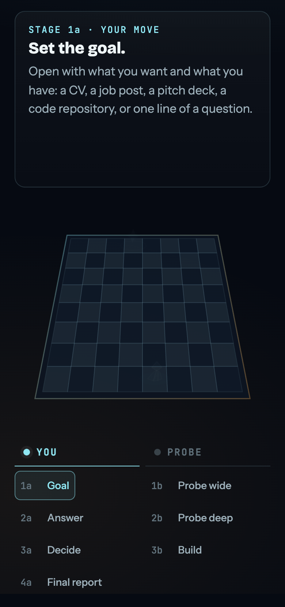

# ProofProbe

Live: https://proofprobe.forested-wolfberry.workers.dev

Staged research that turns any starting point into a clear, data-backed final report: a job or interview to prepare for, a search for side income, a startup idea, or another goal. Research plays out as turns, like a game of chess. You make each "a" move, and the probe answers with each "b" move:

<p align="center"><a href="https://proofprobe.forested-wolfberry.workers.dev"></a></p>

| Turn | You (a) | Probe (b) |
| --- | --- | --- |
| 1 | Set the goal, and bring what you have | Research the whole field, ending in the questions only you can answer |
| 2 | Answer, skip, or point in a new direction | Research deep inside your answers, ending in proposals |
| 3 | Accept, reject, or leave each proposal on Auto | Build the deliverable: a path, PRD, build plan, rulebook or answer |
| 4 | Read the final report, or download it as HTML or PDF | |

- **`/proofprobe` skill** (`skills/proofprobe/SKILL.md`): runs in Claude Code. Opus does the thinking and treg does the live research, so the server needs no AI key.
- **Worker** (`src/`): hosts the home page and the Probes directory, organised as profiles with one or more pages. Pages are public by default, and signing in to the profile unlocks editing. A request can opt into private research: Probes then shows only a teaser card, and the owner decides who else may read it from their account page.
- **`bin/proofprobe.mjs`**: admin helper to create, publish, check and fetch cases.

## For agents and other chats

Read `CLAUDE.md` for the expected flow. In any Claude Code chat, `/proofprobe` runs it, including moving research that was started elsewhere onto a page.

## Setup

```
npm install
node bin/proofprobe.mjs init --url https://<worker-url>
ln -s "$PWD/skills/proofprobe" ~/.claude/skills/proofprobe
npx wrangler login
npx wrangler secret put ADMIN_TOKEN_SHA256     # paste the hash printed by init
openssl rand -base64 32 | npx wrangler secret put PASSWORD_KEY
npx wrangler deploy
node bin/proofprobe.mjs admin-setup             # open the link to choose the master password
```

Local test: put `ADMIN_TOKEN_SHA256=<hash>` and `PASSWORD_KEY=<base64 key>` in `.dev.vars`, run `npm run dev`, then `npm run test:e2e`. The test only ever talks to localhost. `npm run typecheck` checks the Worker.

## Data rules

- Anyone can read a public page's research, questions, submitted answers, status and cost, and a notice says so. That includes requested new directions. Only the signed-in profile and the owner can change it, and unsubmitted drafts stay with them. Private pages open only for their owner, people they approve, and the owner of the site. People apply for a profile, the owner approves it, and signing in unlocks that profile's pages and no others. People can change their own password once signed in.
- People act at Stages 1a, 2a, 3a and 4a: set a goal, answer questions, decide on proposals (Accept, Reject or Auto), then read and download the final report. Stages 1b, 2b and 3b are research the owner runs. Each stage is a view on the same page, and new research never replaces an earlier one.
- Submitting stores a log and starts nothing. Research continues only when `/proofprobe` is run.
- The cost shown on a page is treg data spend logged with `proofprobe cost`. Claude usage is not included.
- Submissions are append-only. A database trigger blocks updates, and each log stores a SHA-256 so corruption is detectable.
- Page content is rendered as text only, so stored content cannot inject markup.
- CVs and research notes stay in `.proofprobe/` on this machine, which git ignores. The server holds what the site needs: questions, research, costs, answers and decisions (submitted ones are public on public pages, drafts stay private), and goal requests with their files (private to the owner).
- Answer text and tokens are never logged.
- Spam limits run on the free tier: per-device and per-profile hourly and daily caps on profile applications, goal requests and access requests, a cap of 3 waiting requests per profile, a 500 MB ceiling on uploaded files, a 1 MB limit on other requests, a hidden honeypot field and a minimum fill time on forms, a pause after 20 wrong sign-ins from one device, and a check that writes come from this site.

## Design choices

This is a small free-tier app: one Cloudflare Worker and a D1 database, with owner-approved profiles instead of a full account system. D1 can be moved to Postgres later with pgloader if the tool outgrows it. The schema is applied on first request, so there is no separate migration step.

## Open source and access

The code is public, but the running service is not. Cases, answers and links live in the owner's Cloudflare account, and nothing in this repo gives access to them. The admin token stays in `.proofprobe/`, which is never committed. Profile passwords are encrypted in the database, and the master password is stored only as a salted hash. The Worker holds only a hash of the token, as a Cloudflare secret.

To run your own copy, replace `account_id` and `database_id` in `wrangler.jsonc` with your own.

## License

MIT
